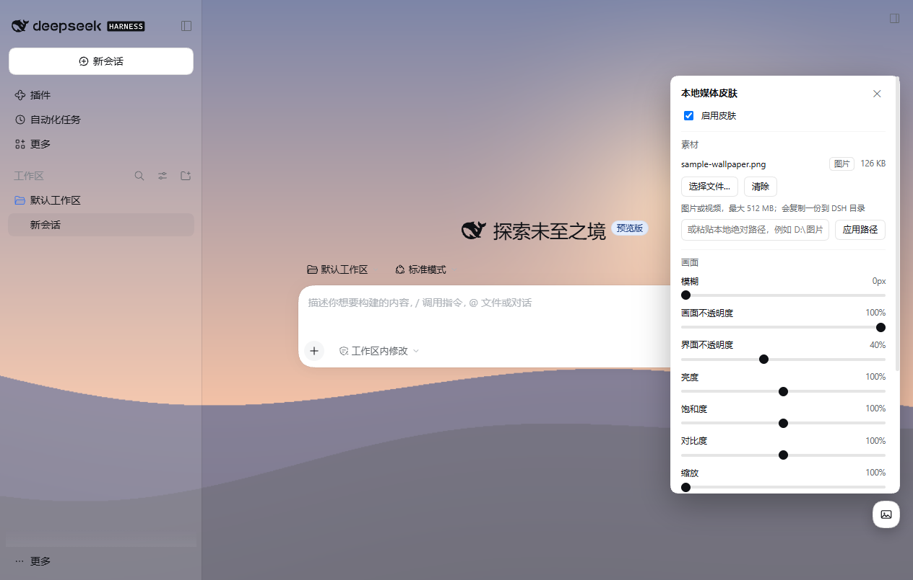
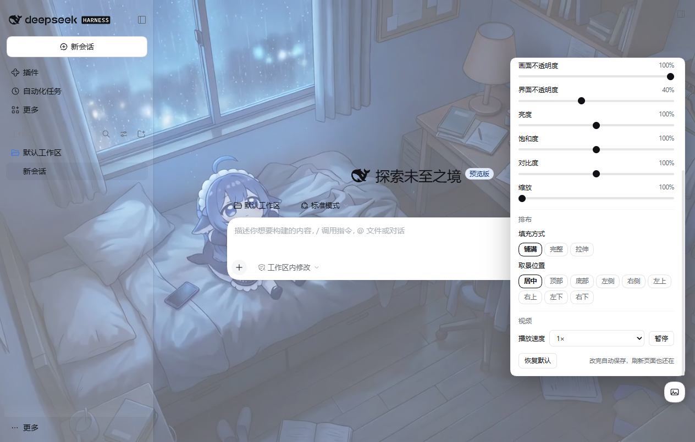

# dsh-media-skin

DSH 的**本地媒体皮肤**：把任意本地图片 / 视频铺成 Web 界面背景，右下角面板里实时调
模糊、画面/界面不透明度、亮度、饱和度、对比度、缩放、填充方式、取景位置，
视频还能调播放速度和暂停。设置自动保存，刷新页面还在。

| 图片背景 | 视频背景（1.5×） |
| --- | --- |
|  |  |

> 两张图来自一个只装了 `dsh-base` + `dsh-web-app` + 本插件的独立实例（真实 Chromium）。

## 怎么用

1. 点窗口右下角的**相框圆钮**打开面板（在视口右下角、比底边高一点，避开别的插件的小按钮）。
2. 选素材，两种方式任选：
   - **选择文件…**：挑一张图片或一段视频。插件把副本写进
     `$DSH_HOME/dsh-media-skin/media/`（默认 `C:\Users\<你>\.dsh\...`），原文件之后可以随便移动；
   - **粘贴本地绝对路径** + 回车 / **应用路径**：不复制、直接读原文件；文件被移动或删除时
     面板会显示文件名并提示"文件读不到了"。
3. 拖滑块调画面：改动本地立即生效，约 0.3 秒后写回设置文件。

## 面板

| 分组 | 项 | 范围 |
| --- | --- | --- |
| 开关 | 启用皮肤 | 关掉回到原生外观（素材配置保留） |
| 素材 | 选择文件 / 清除 / 应用路径 | — |
| 画面 | 模糊 · 画面不透明度 · 界面不透明度 | 0–60 px · 0–100% · **0–100%（0 = 原始素材）** |
| 画面 | 亮度 · 饱和度 · 对比度 · 缩放 | 40–160% · 0–200% · 50–150% · 100–170% |
| 排布 | 填充方式（铺满/完整/拉伸）· 取景位置（九宫格） | — |
| 视频 | 播放速度（0.5×–2×）· 播放/暂停 | 仅视频素材 |

## 目录

```
index.js            宿主：设置读写、上传、带 Range 的素材路由
lib/defaults.js     设置默认值、区间、清洗
lib/store.js        $DSH_HOME 下的设置文件（原子写）
lib/media.js        素材识别 / 保存 / 定位
lib/http.js         JSON 响应、请求体、Range 下发
client.js           客户端：背景层引擎 + 右下角面板（React，注册到 shell.overlay）
cordis.patch.yml    bundle patch（插一行 media-skin）
locale/*.json       插件管理器里的标题/描述（中英文）
docs/DETAIL*.md     插件详情页（一行特性图 preview.svg）
docs/screenshots/   上面两张实测截图
icon.svg            插件图标（原创）
tests/smoke.mjs     纯函数 + Range 下发的回归测试：node tests/smoke.mjs
scripts/            本地验收用（造独立 DSH_HOME、生成示例壁纸），不参与运行时
```

## 设置文件

`$DSH_HOME/dsh-media-skin.json`（默认 `~/.dsh/dsh-media-skin.json`）。界面上的改动都写这里；
也可以手改，刷新页面即生效。插件**不写** profile 的 `cordis.patch.yml`。

## 接口

| 方法 | 路径 | 说明 |
| --- | --- | --- |
| GET | `/dsh-media-skin/api/state` | 当前设置 + 素材信息（类型/大小/URL） |
| POST | `/dsh-media-skin/api/state` | 合并一份设置补丁并落盘 |
| POST | `/dsh-media-skin/api/upload` | 上传素材副本，文件名走 `x-dms-name` 头 |
| GET | `/dsh-media-skin/media` | 下发当前素材，支持 Range |

## 安装

```sh
# npm
dsh plugin --profile <profile> add dsh-media-skin

# 或直接从 GitHub 源码装（无构建步骤，纯 JS）
dsh plugin --profile <profile> add github:svd748xyz/dsh-media-skin
```

本地开发也可以直接指目录：`dsh plugin --profile <profile> add "<本仓库路径>"`，或在 GUI 的
**设置 → 插件 → 添加插件** 里选这个目录。

装完**刷新页面**即可（客户端模块会热加载；换包体内容才需要完全重启 DSH）。

零依赖、零构建、不联网：插件只读写 `$DSH_HOME` 下自己的设置文件与素材副本，
不碰 profile 的 `cordis.patch.yml`，卸载后界面恢复原生外观。
