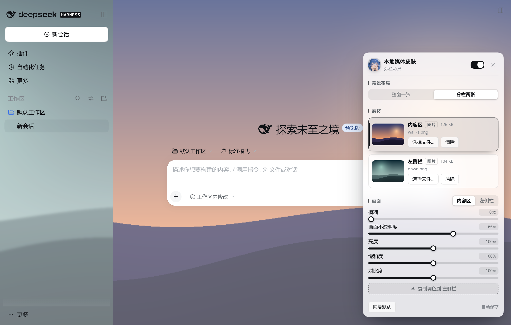
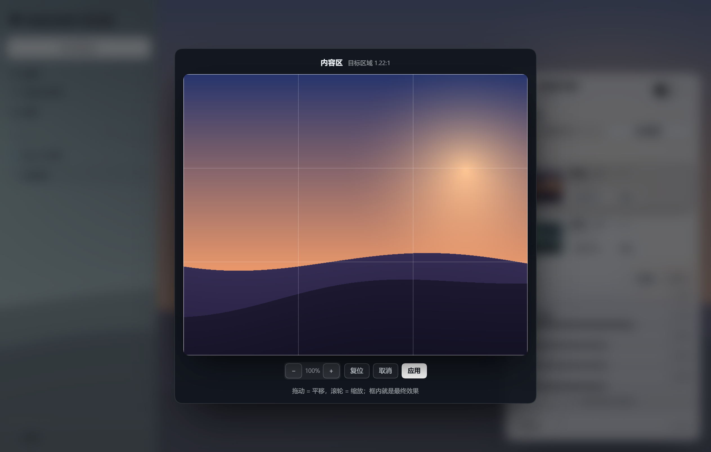
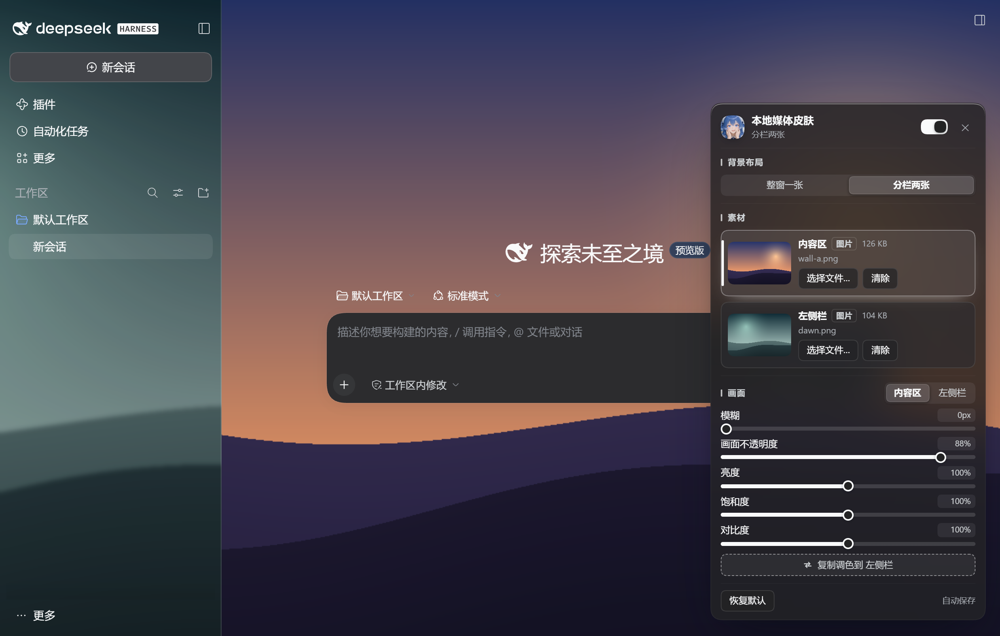
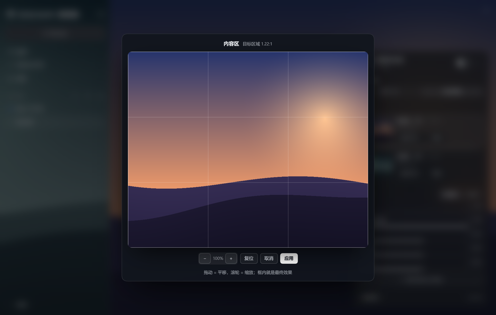

# dsh-media-skin

DSH 的**本地媒体皮肤**：把任意本地图片 / 视频铺成 Web 界面背景。

- **两种布局**：整窗一张图；或者分栏——内容区与左侧栏各自一张图。
- **手动裁切**：每个图层都有自己的裁切器，拖动选位置、滚轮缩放，预览框里就是最终效果；
  不再有"填充方式 / 取景位置 / 缩放"这些替你猜的固定选项。
- **每层一套画面参数**：模糊、画面不透明度、亮度、饱和度、对比度按图层分别调，
  点素材卡切换当前调节对象，滑块永远只有一组。只有"画面不透明度"这一个淡出旋钮，
  全局面板不再重复一份。
- **模糊不动取景**：模糊是盖在素材上的一层 `backdrop-filter`，素材元素永远铺满视口，
  拖模糊时不会像以前那样把整张图自己放大一圈。
- **一键复制调色**：分栏时把当前这层的五个参数整组复制到另一层（虚线胶囊按钮，
  点完变“已同步”），两张图想调成同一个调子不用来回拖十条滑块。
- **界面**：磨砂玻璃面板、分段控件、填充式滑轨；右下角圆钮就是**DS 蓝鲸厨娘**本人
  （同人形象图裁成的圆形头像，走插件自己的 `/dsh-media-skin/avatar` 路由下发）。
- **亮色 / 深色都跟随**：颜色全部走 DSH 的 `--dsw-alias-*` token，切主题自动变。唯一要
  手动照顾的是深色主题把 `brand-primary` 换成了近白，所以"主色底 + 白字/白点"的地方
  （开关圆点、滑轨拇指、主按钮、`已同步`）改用 `bg-layer-1` 当前景色，不会白对白。
- 视频还有播放速度与暂停。设置自动保存，刷新页面还在。

| 整窗一张（浅色） | 分栏两张（浅色） |
| --- | --- |
|  |  |

| 手动裁切（拖动取景 / 滚轮缩放） | 分栏（深色主题） |
| --- | --- |
|  |  |

| 裁切器（深色主题） |
| --- |
|  |

> 五张都是 2528×1610（1264×805 @2x）实拍：只装了 `dsh-base` + `dsh-web-app` + 本插件的
> 独立实例，真实 Chromium，`scripts/make-verify-home.mjs` 造的环境；壁纸是脚本生成的示例图。
> 深色两张是同一套环境下 `--theme dark` 重启后拍的，用来验收面板、滑轨、开关、裁切器在
> 深色主题里的可读性（深色下 `brand-primary` 会变成近白，见 `client.js` 的“深色壳补偿”）。

## 怎么用

1. 点窗口右下角的**蓝鲸厨娘头像**打开面板（在视口右下角、比底边高一点，避开别的插件的小按钮）。
2. 在素材卡上点**选择文件…**，挑一张图片或一段视频。插件把副本写进
   `$DSH_HOME/dsh-media-skin/media/`（默认 `C:\Users\<你>\.dsh\...`），原文件之后可以随便移动。
3. 点**缩略图**进裁切器：拖动选位置、滚轮缩放，确认后即生效。
4. 点素材卡把"画面"滑块切到那一层，分别调色：改动本地立即生效，约 0.3 秒后写回设置文件。
5. 分栏调好一层后，点**复制调色到 …** 把这一套参数整组给另一层；只复制画面参数，
   素材与裁切不动。

## 面板

| 分组 | 项 | 说明 |
| --- | --- | --- |
| 开关 | 启用皮肤（标题栏右侧的胶囊开关） | 关掉回到原生外观（素材与裁切配置保留） |
| 布局 | 整窗一张 / 分栏两张 | 分栏 = 内容区 + 左侧栏各自独立 |
| 素材 | 每个图层一张卡 | 选择文件 / 清除；点缩略图进裁切器，点卡片切换调节对象 |
| 裁切器 | 拖动 + 滚轮 | 预览框按目标区域比例绘制，所见即所得 |
| 画面（每层） | 模糊 · 画面不透明度 · 亮度 · 饱和度 · 对比度 | 0–60 px · 0–100% · 40–160% · 0–200% · 50–150% |
| 画面（分栏） | 复制调色到「另一层」 | 五个参数整组过去；素材与裁切不变 |
| 视频 | 播放速度（0.5×–2×）· 播放/暂停 | 仅视频素材 |

裁切参数存的是 `{x, y, zoom}`：`x/y` 是取景中心（0–1），`zoom` 是相对 cover 的放大倍数（1–4）。
背景层与裁切器用同一套 `object-fit:cover; object-position; transform:scale`，所以不会出现
"预览好看、落地变形"。


## 设计参考

界面是手写 CSS，没有引入任何组件库、图标包或字体文件。下面几个 MIT 项目只在“手法”层面
给过参照（毛玻璃分层、分段控件、填充式滑轨、克制的标签层级），**没有复制它们的代码或素材**：

- [shadcn/ui](https://github.com/shadcn-ui/ui) — MIT，浮层与分段控件的形态
- [Radix Colors](https://github.com/radix-ui/colors) — MIT，明度阶梯的取法
- [Catppuccin](https://github.com/catppuccin/catppuccin) — MIT，低饱和配色的分寸

配色本身全部走 DSH 自己的 `--dsw-alias-*` token（背景/描边/文字/主色各取对应层级的语义色），
所以亮暗主题、用户改主题色都会自动跟随，不会出现“面板颜色跟界面打架”。

界面里的头像与插件图标不是本项目画的：用的是社区对 DeepSeek 的二次元人化形象
「DS 蓝鲸厨娘」的同人图，由 `scripts/make-avatar.py` 裁切成正方形并生成
`assets/avatar.png`、`assets/icon-180.png`、`icon.svg` 三件产物。


## 目录

```
index.js            宿主：设置读写、上传、带 Range 的素材路由
lib/defaults.js     设置默认值、区间、清洗
lib/store.js        $DSH_HOME 下的设置文件（原子写）
lib/media.js        素材识别 / 保存 / 定位
lib/http.js         JSON 响应、请求体、Range 下发
client.js           客户端：背景层引擎 + 右下角面板（React，注册到 shell.overlay）
cordis.patch.yml    bundle patch（插一行 media-skin）
locale/*.json       插件管理器里的标题/描述（中英文）
docs/DETAIL*.md     插件详情页（一行特性图 preview.svg）
docs/screenshots/   上面五张实测截图（2528×1610，浅色三张 + 深色两张）
icon.svg            插件图标：蓝鲸厨娘（圆角底板 + 内嵌 160px 位图，DSH 按 SVG 下发最稳）
assets/avatar.png   应用内头像（256px，宿主 /avatar 路由下发）
assets/icon-180.png 目录站用的 180px 位图
scripts/make-avatar.py  从同人图裁出上面三件产物（改图只跑这一个脚本）
tests/smoke.mjs     纯函数 + Range + 宿主快照的回归测试：node tests/smoke.mjs
tests/harness/      浏览器验收页（React UMD + 假宿主），直接 file:// 打开 index.html
scripts/            本地验收用（造独立 DSH_HOME、生成示例壁纸），不参与运行时
```

## 设置文件

`$DSH_HOME/dsh-media-skin.json`（默认 `~/.dsh/dsh-media-skin.json`）。界面上的改动都写这里；
也可以手改，刷新页面即生效。插件**不写** profile 的 `cordis.patch.yml`。

v4 结构的关键是 `layers`：每个图层一份素材、一份裁切、一份画面参数。全局只剩开关与布局。

```json
{
  "version": 4,
  "mode": "split",
  "layers": {
    "full":    { "media": { "source": "upload", "path": "wall.jpg", "name": "wall.jpg" },
                 "crop": { "x": 0.5, "y": 0.5, "zoom": 1 },
                 "look": { "blur": 0, "mediaOpacity": 100, "brightness": 100, "saturate": 100, "contrast": 100 } },
    "main":    { "media": { "source": "none", "path": "", "name": "" }, "crop": { "x": 0.5, "y": 0.5, "zoom": 1 }, "look": { "...": "同上" } },
    "sidebar": { "media": { "source": "upload", "path": "side.jpg", "name": "side.jpg" },
                 "crop": { "x": 0.5, "y": 0.5, "zoom": 1.4 },
                 "look": { "blur": 6, "mediaOpacity": 66, "brightness": 70, "saturate": 100, "contrast": 100 } }
  }
}
```

旧文件读入时自动迁移：v1 的顶层 `media` 搬进 `layers.full`，九宫格位置翻译成 `crop.x/y`、
`scale` 翻译成 `crop.zoom`、`fit` 落到 cover；v2 的顶层画面参数复制到三个图层的 `look`；
**v3 的两条全局压色（`surface` / `sidebar`）会按 `mediaOpacity × (1 − surface/100)` 折进各层，
然后删掉这两个键**——观感基本不变，之后只有"画面不透明度"这一个淡出旋钮。


## 接口

| 方法 | 路径 | 说明 |
| --- | --- | --- |
| GET | `/dsh-media-skin/avatar` | 插件头像位图（`assets/avatar.png`，`no-cache` + ETag） |
| GET | `/dsh-media-skin/api/state` | 当前设置 + 三个图层的素材信息（类型/大小/URL） |
| POST | `/dsh-media-skin/api/state` | 合并一份设置补丁并落盘 |
| POST | `/dsh-media-skin/api/upload` | 上传素材副本；文件名走 `x-dms-name`，图层走 `x-dms-layer`（full / main / sidebar） |
| GET | `/dsh-media-skin/media?layer=main` | 下发指定图层素材，支持 Range |

## 安装

```sh
# npm
dsh plugin --profile <profile> add dsh-media-skin

# 或直接从 GitHub 源码装（无构建步骤，纯 JS）
dsh plugin --profile <profile> add github:svd748xyz/dsh-media-skin
```

本地开发也可以直接指目录：`dsh plugin --profile <profile> add "<本仓库路径>"`，或在 GUI 的
**设置 → 插件 → 添加插件** 里选这个目录。

装完**刷新页面**即可（客户端模块会热加载；换包体内容才需要完全重启 DSH）。

零依赖、零构建、不联网：插件只读写 `$DSH_HOME` 下自己的设置文件与素材副本，
不碰 profile 的 `cordis.patch.yml`，卸载后界面恢复原生外观。
